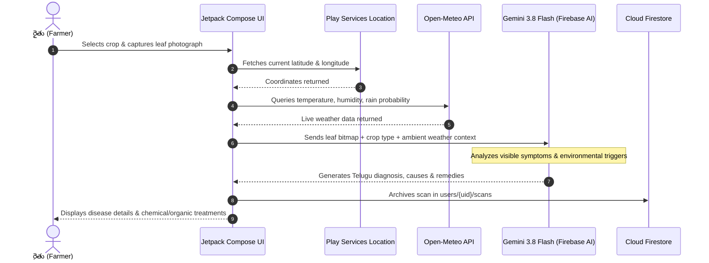

# Rythu Mitra (రైతు మిత్ర) – AI-Powered Telugu Farmer Assistant

[](https://kotlinlang.org)
[](https://developer.android.com/jetpack/compose)
[](https://firebase.google.com)
[](https://deepmind.google/technologies/gemini/)
[](https://developer.android.com)
[-25D366.svg?style=flat&logo=whatsapp&logoColor=white)](https://github.com/shaikafnan787-hash/RythuMitraApp)

> **రైతు మిత్ర (Rythu Mitra)** is an intelligent, Telugu-first agricultural companion designed specifically for farmers across Andhra Pradesh and Telangana. By combining Google Gemini 3.8 Flash multimodal artificial intelligence, real-time hyper-local weather intelligence, and seamless peer-to-peer APK distribution over WhatsApp and Telegram, Rythu Mitra empowers farmers to instantly diagnose crop diseases through camera photos, receive automated weather warnings, and manage their crops with zero technical barriers.

---

## 📌 Table of Contents
1. [Project Overview](#1-project-overview)
2. [Problem Statement](#2-problem-statement)
3. [Project Objectives](#3-project-objectives)
4. [Key Features](#4-key-features)
5. [Technology Stack](#5-technology-stack)
6. [Application Architecture](#6-application-architecture)
7. [Firebase Backend & Security](#7-firebase-backend--security)
8. [AI Crop Disease Detection Workflow](#8-ai-crop-disease-detection-workflow)
9. [Hyper-Local Weather Intelligence](#9-hyper-local-weather-intelligence)
10. [Smart Farmer Alert Engine](#10-smart-farmer-alert-engine)
11. [Firestore Data Architecture](#11-firestore-data-architecture)
12. [Grassroots Distribution: Direct APK Sharing](#12-grassroots-distribution-direct-apk-sharing)
13. [Installation & Setup for Developers](#13-installation--setup-for-developers)
14. [Build & Compilation Instructions](#14-build--compilation-instructions)
15. [Application Screenshots](#15-application-screenshots)
16. [Future Roadmap](#16-future-roadmap)
17. [Author & Credits](#17-author--credits)

---

## 1. Project Overview

Agriculture is the lifeblood of millions of rural households in the Telugu-speaking states of Andhra Pradesh and Telangana. However, smallholder farmers often suffer major economic losses due to delayed plant disease diagnoses, unexpected rainfall, and agricultural guidance presented in English or overly technical terms.

**Rythu Mitra** was built from the ground up to solve these real-world challenges:
- **Telugu-First Design:** Entire application interface, diagnostic explanations, and alerts are written in colloquial Telugu.
- **Multimodal AI Pathology:** Farmers simply snap a photograph of an infected crop leaf. Google Gemini 3.8 Flash analyzes the visual symptoms along with live temperature, humidity, and rainfall conditions to recommend immediate treatments.
- **Grassroots Direct Distribution:** Instead of relying on the Google Play Store, the app is distributed directly to farmers as a standalone APK shared peer-to-peer through WhatsApp, Telegram, and local farmer groups.

---

## 2. Problem Statement

Smallholder and marginal farmers face several critical bottlenecks in day-to-day farming:
- **Language & Literacy Barriers:** The vast majority of agritech solutions are published in English or generic Hindi, alienating rural Telugu farmers who need actionable advice in their mother tongue.
- **High Pathology Turnaround Time:** Consulting agricultural university extension officers or visiting Krishi Vigyan Kendras (KVKs) often takes days, during which pest infestations can devastate an entire harvest.
- **Microclimate Vulnerability:** Sudden unseasonal rainfall during harvest or high humidity during flowering triggers severe fungal diseases (e.g., blast, blight, powdery mildew) without timely warning.
- **Play Store Friction:** Many rural farmers have shared family phones, inconsistent Google Play Store account setups, or limited app store access. Requiring app store downloads and phone OTP registrations creates an unnecessary barrier to adoption.

---

## 3. Project Objectives

- **Democratize Agricultural AI:** Bring Google's cutting-edge Gemini 3.8 Flash vision model directly into the hands of Telugu farmers.
- **Deliver Actionable Disease Solutions:** Provide both organic (సేంద్రీయ పద్ధతులు) and chemical (రసాయన నివారణ) treatment steps.
- **Hyper-Local Meteorological Awareness:** Combine GPS coordinates with real-time weather feeds to warn against rainfall, storms, extreme heat, and high fungal risk.
- **Zero-Friction Access:** Implement Firebase Anonymous Authentication so farmers can immediately use all features without sign-ups or passwords.
- **Community-Driven Distribution:** Enable frictionless peer-to-peer distribution via direct APK sharing across WhatsApp, Telegram, and Bluetooth.

---

## 4. Key Features

| Feature | Telugu Name | Description |
|---|---|---|
| **AI Leaf Disease Scan** | ఫోటో ద్వారా రోగ నిర్ధారణ | Take a picture of an affected crop leaf. Gemini AI analyzes the symptoms and provides instant diagnosis and remedies in Telugu. |
| **Live Weather Dashboard** | ప్రత్యక్ష వాతావరణం | Real-time monitoring of temperature, relative humidity, rainfall probability, precipitation, and wind velocity. |
| **Smart Advisory Alerts** | రైతు హెచ్చరికలు | Automated rules engine that issues alerts based on crop growth stages and meteorological conditions. |
| **My Crops Tracker** | నా పంటలు | Add and track crops with planting dates, phenological stages (వరి, మిర్చి, పత్తి, వేరుశనగ), water requirements, and field notes. |
| **Scan History** | స్కాన్ చరిత్ర | Cloud-synced archive of previous diagnoses and treatment recommendations in Firestore. |
| **Farmer Profile** | రైతు వివరాలు | Simple profile storage for farmer name, village, landholding acreage, and primary crops. |
| **Peer-to-Peer Sharing** | సులభమైన భాగస్వామ్యం | Built as a lightweight, self-contained APK for easy forwarding across WhatsApp and Telegram. |

---

## 5. Technology Stack

- **Core Platform:** Android (Min SDK: 24 / Android 7.0+, Target & Compile SDK: 37 / Android 14+)
- **Programming Language:** Kotlin 2.0+
- **Modern UI:** Jetpack Compose with Material Design 3 and animated screen transitions
- **AI / Multimodal LLM:** Google Gemini 3.8 Flash via `com.google.firebase:firebase-ai` (Firebase AI Logic)
- **Authentication:** Firebase Authentication (Anonymous Auth Session)
- **Database:** Cloud Firestore (`com.google.firebase:firebase-firestore`)
- **API Security:** Firebase App Check with reCAPTCHA Enterprise
- **Weather Services:** Open-Meteo Free & Open-Source Weather API
- **Location Services:** Google Play Services Fused Location Provider (`play-services-location:21.3.0`)
- **Camera & Media:** Android Activity Result Contracts (`TakePicture`, `GetContent`)
- **Build Tool:** Gradle 9.5 with Kotlin DSL (`build.gradle.kts`) and Version Catalogs

---

## 6. Application Architecture

Rythu Mitra follows clean architecture principles with distinct separation of concerns:

```
┌────────────────────────────────────────────────────────┐
│                   UI Layer (Jetpack Compose)           │
│  - MainActivity (Navigation, Tab Layout, Camera)       │
│  - AlertsScreen (Smart Advisory Feeds)                 │
│  - ScanHistoryScreen (Historical Disease Scans)        │
│  - Theme / Material 3 Design Tokens (Colors, Type)     │
└───────────────────────────▲────────────────────────────┘
                            │
┌───────────────────────────┴────────────────────────────┐
│                   Domain / Engine Layer                │
│  - SmartAlertEngine (Weather & Crop Correlation Rules) │
│  - FarmerAlert (Data Model & Priority Ratings)         │
└───────────────────────────▲────────────────────────────┘
                            │
┌───────────────────────────┴────────────────────────────┐
│                    Data / Repository Layer             │
│  - CropRepository (Firestore CRUD under users/{uid})   │
│  - ProfileRepository (Farmer profile persistence)      │
│  - ScanRepository (Scan records persistence)           │
│  - FirebaseAuthManager (Silent anonymous auth session) │
└───────────────────────────▲────────────────────────────┘
                            │
┌───────────────────────────┴────────────────────────────┐
│               External Services & Cloud APIs           │
│  - Google Gemini 3.8 Flash (Firebase AI Logic)         │
│  - Cloud Firestore Cloud Database                      │
│  - Open-Meteo Meteorological REST API                  │
│  - Google Play Services Fused Location Provider        │
└────────────────────────────────────────────────────────┘
```

---

## 7. Firebase Backend & Security

1. **Anonymous Authentication (`firebase-auth`):**  
   Automatically provisions a persistent, unique user ID (`uid`) upon first launch without asking for passwords, phone numbers, or OTPs.
2. **Cloud Firestore (`firebase-firestore`):**  
   Stores user profiles, crops, and scan histories in isolated subcollections under `users/{uid}`.
3. **Firebase AI Logic (`firebase-ai`):**  
   Direct integration with Google's Gemini 3.8 Flash (`GenerativeBackend.googleAI()`). It processes image bitmaps alongside prompt templates engineered specifically for Telugu crop pathology.
4. **Firebase App Check (`firebase-appcheck-recaptcha`):**  
   Protects backend resources against scrapers, replay attacks, and unauthorized clients.

---

## 8. AI Crop Disease Detection Workflow



---

## 9. Hyper-Local Weather Intelligence

The app fetches real-time meteorological metrics via Open-Meteo using the farmer's GPS coordinates:
- **Temperature (°C):** Monitors heat stress during sensitive growth stages.
- **Relative Humidity (%):** High humidity (>85%) triggers alerts for rapid fungal and bacterial proliferation.
- **Rain Probability & Precipitation (mm):** Informs farmers whether to postpone chemical spraying to prevent chemical washout.
- **Wind Speed (km/h):** High winds (>25 km/h) trigger spray drift warnings.
- **Next-Day Storm Forecast:** Weather codes (95, 96, 99) trigger urgent storm preparation warnings.

---

## 10. Smart Farmer Alert Engine

The `SmartAlertEngine` cross-references active crops and their growth stages with real-time weather metrics:

| Alert Type | Threshold / Condition | Priority | Telugu Advisory Summary |
|---|---|:---:|---|
| **Storm Warning** | Weather codes 95, 96, 99 | High (1) | రాబోయే తుఫాను హెచ్చరిక – పొలంలో జాగ్రత్తలు తీసుకోండి |
| **Heavy Rain Alert** | Rain probability ≥ 70% | High (1) | భారీ వర్ష సూచన – పురుగుమందుల పిచికారీ నిలిపివేయండి |
| **High Wind Warning** | Wind speed ≥ 25 km/h | High (1) | వేగంగా వీచే గాలులు – ఎరువులు లేదా స్ప్రేయింగ్ చేయవద్దు |
| **Heat Wave Alert** | Temperature ≥ 40°C | High (1) | తీవ్రమైన వేడి – పంటలకు సకాలంలో నీటి తడులు అందించండి |
| **Fungal Disease Risk** | Humidity ≥ 85% | Medium (2) | అధిక తేమ – శిలీంధ్ర తెగుళ్లు ఆశించే అవకాశం ఉంది |
| **Flowering Stage Advisory** | Crop in పూత దశ (Flowering) | Medium (2) | పూత దశ జాగ్రత్తలు – నీటి నిల్వ లేకుండా చూసుకోండి |
| **Vegetative Stage Advisory** | Crop in పెరుగుదల దశ (Growth) | Medium (2) | పెరుగుదల దశ – చీడపీడల గమనింపు అవసరం |

---

## 11. Firestore Data Architecture

All user data is partitioned under the authenticated farmer's UID:

```
users/
└── {userId}/
    ├── profile/
    │   └── info
    │       ├── farmerName: String
    │       ├── village: String
    │       ├── mainCrop: String
    │       └── landSize: String
    │
    ├── crops/
    │   └── {cropId}
    │       ├── id: String
    │       ├── name: String
    │       ├── cropType: String
    │       ├── plantedDate: String
    │       ├── growthStage: String
    │       ├── waterRequirement: String
    │       ├── notes: String
    │       └── createdAt: Long
    │
    └── scans/
        └── {scanId}
            ├── id: String
            ├── cropName: String
            ├── result: String
            └── createdAt: Long
```

---

## 12. Grassroots Distribution: Direct APK Sharing

### Why Direct APK Sharing?
In rural communities, peer-to-peer distribution over messaging applications like **WhatsApp** and **Telegram** is often much faster and more accessible than navigating the Google Play Store:
- **No Google Account Required:** Farmers do not need a configured Google Play Store account or credit card.
- **Village-Level Viral Distribution:** One progressive farmer or village coordinator can forward the APK directly into local village farmer groups.
- **Offline Forwarding:** The `.apk` file can be shared locally via Bluetooth, Nearby Share / Quick Share, or SD cards.

### How Farmers Install the APK:
1. **Receive:** The farmer receives `RythuMitra.apk` via a WhatsApp or Telegram group.
2. **Download:** Tap the file to download it to the device.
3. **Allow Installation:** If prompted with *"For your security, your phone is not allowed to install unknown apps from this source"*, tap **Settings** and toggle **Allow from this source**.
4. **Install:** Tap **Install** and open **Rythu Mitra (రైతు మిత్ర)**.
5. **Instant Use:** The app immediately signs in anonymously in the background — no passwords or phone numbers required.

---

## 13. Installation & Setup for Developers

### Prerequisites
- Android Studio Ladybug (2024.2.1) or newer
- JDK 11 or JDK 17
- Android SDK Platform 34+
- Physical Android phone or emulator running Android 7.0+ (API 24+)

### Clone the Repository
```bash
git clone https://github.com/shaikafnan787-hash/RythuMitraApp.git
cd RythuMitraApp
```

### Firebase Configuration
1. Create a Firebase project in the [Firebase Console](https://console.firebase.google.com/).
2. Add an Android app with package name:
   ```text
   com.Afnan.rythumitraapp
   ```
3. Enable **Anonymous Authentication** in the Firebase Console under **Authentication > Sign-in method**.
4. Enable **Cloud Firestore** and configure appropriate security rules.
5. Enable **Firebase AI Logic / Vertex AI in Firebase** to support Gemini 3.8 Flash.
6. Place your generated `google-services.json` inside the `app/` folder.

---

## 14. Build & Compilation Instructions

### Generating APK for Direct Sharing
To generate the release or debug APK for distribution via WhatsApp or Telegram:

- **Build Debug APK:**
  ```bash
  ./gradlew assembleDebug
  ```
  *Output location:* `app/build/outputs/apk/debug/app-debug.apk`

- **Build Release APK:**
  ```bash
  ./gradlew assembleRelease
  ```
  *Output location:* `app/build/outputs/apk/release/app-release-unsigned.apk`

- **Run Unit Tests:**
  ```bash
  ./gradlew test
  ```

- **Run Android Lint Analysis:**
  ```bash
  ./gradlew lint
  ```

---

## 15. Application Screenshots

| Home & Weather | AI Disease Scan | Smart Alerts | My Crops & Profile |
|:---:|:---:|:---:|:---:|
| *(Screenshot Placeholder)* | *(Screenshot Placeholder)* | *(Screenshot Placeholder)* | *(Screenshot Placeholder)* |

---

## 16. Future Roadmap

- 🎙️ **Telugu Voice Interface (వాయిస్ కమాండ్లు):** Hands-free voice querying for elderly or illiterate farmers using speech-to-text.
- 📡 **On-Device Edge ML:** TensorFlow Lite model integration for offline leaf diagnostics in areas with zero cell connectivity.
- 💰 **APMC Market Yard Prices (మార్కెట్ ధరలు):** Daily crop price feeds from agricultural market committees across Andhra Pradesh and Telangana.
- 🧪 **IoT Soil & Moisture Integration:** Bluetooth LE pairing with low-cost soil moisture and pH probes for automated irrigation scheduling.
- 🧑‍🌾 **Rythu Vedika Community:** In-app village forums for farmers to report local pest outbreaks to neighboring fields.

---

## 17. Author & Credits

- **Developer:** [Shaik Afnan / Irshad](https://github.com/shaikafnan787-hash)
- **GitHub Profile:** [@shaikafnan787-hash](https://github.com/shaikafnan787-hash)
- **GitHub Repository:** [RythuMitraApp](https://github.com/shaikafnan787-hash/RythuMitraApp)
- **Special Thanks:**
  - Google DeepMind & Firebase teams for the **Gemini 3.8 Flash** model and **Firebase AI Logic**.
  - **Open-Meteo** for reliable, open meteorological APIs.
  - The hardworking farmers of Andhra Pradesh and Telangana who inspire technological innovation in agriculture.

---

<p align="center">
  <b>రైతే దేశానికి వెన్నెముక — జై జవాన్, జై కిసాన్! 🌾</b>
</p>
