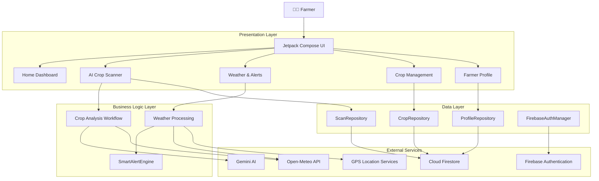
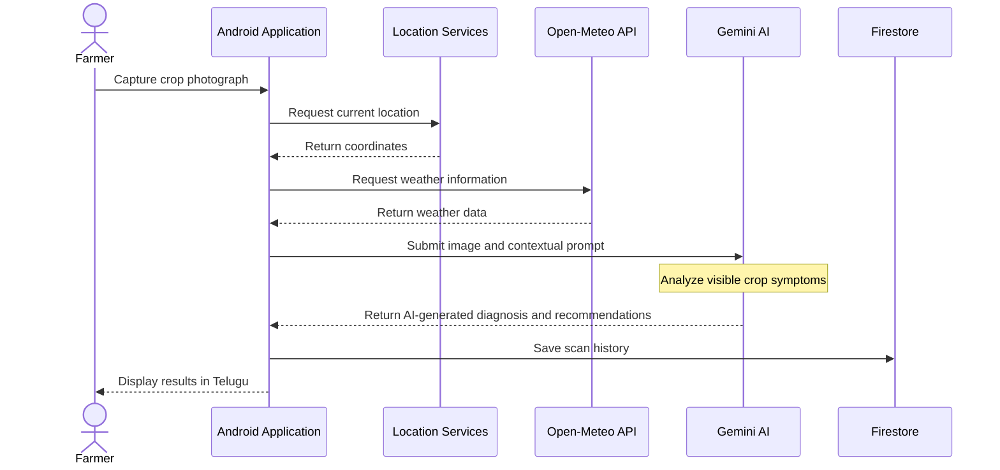
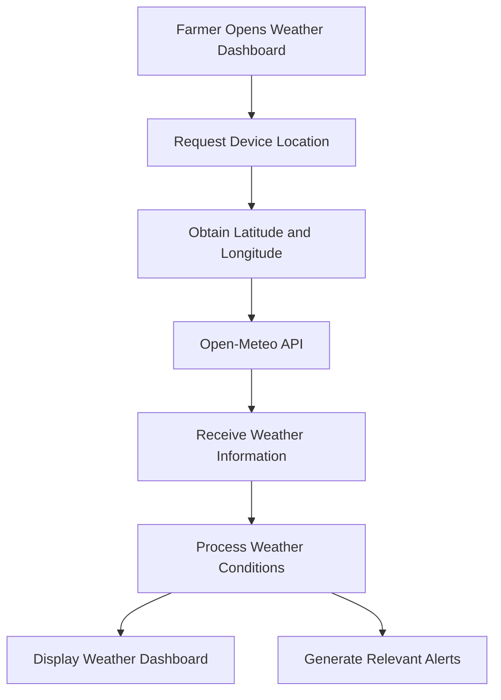

<div align="center">

# 🌾 RYTHU MITRA
### రైతు మిత్ర – AI-Powered Telugu Farmer Assistant

**Smart Agriculture. Artificial Intelligence. Empowering Farmers.**

An AI-powered Android application designed to help Telugu-speaking farmers identify crop diseases, monitor weather conditions, manage crops, and receive intelligent agricultural advisories in their native language.

<br/>

[](https://kotlinlang.org/)
[](https://developer.android.com/jetpack/compose)
[](https://firebase.google.com/)
[](https://deepmind.google/technologies/gemini/)
[](https://developer.android.com/)

[**View Repository**](https://github.com/shaikafnan787-hash/RythuMitraApp) · [**Report an Issue**](https://github.com/shaikafnan787-hash/RythuMitraApp/issues)

</div>

---

## 📖 About the Project

**Rythu Mitra (రైతు మిత్ర)** is an AI-powered agricultural assistant developed specifically for farmers in Andhra Pradesh and Telangana.

Many farmers face challenges in identifying crop diseases, understanding changing weather conditions, and accessing reliable agricultural information in their native language.

Rythu Mitra addresses these challenges through a combination of:

- 🤖 Google Gemini AI for image-based crop disease analysis.
- 🌦️ Open-Meteo API for weather information and forecasts.
- 🔔 Intelligent agricultural alerts based on weather and crop conditions.
- 🌱 Crop management and growth-stage tracking.
- ☁️ Firebase-powered cloud data synchronization.
- 🗣️ A Telugu-first user experience.

The application is built using Kotlin and Jetpack Compose, with an emphasis on simplicity, accessibility, and practical agricultural assistance.

## 🎯 Problem Statement

Farmers encounter several challenges that can negatively affect agricultural productivity.

| Problem | Impact |
|---|---|
| Delayed disease identification | Crop damage and financial losses |
| Unpredictable weather | Damage to crops and agricultural activities |
| Language barriers | Difficulty accessing agricultural information |
| Lack of crop monitoring | Poor tracking of planting dates and growth stages |
| Limited digital accessibility | Difficulty adopting conventional agricultural applications |

### 💡 Our Solution

Rythu Mitra provides a single mobile platform that combines AI-assisted crop analysis, weather intelligence, crop management, and agricultural alerts in Telugu.

The objective is to make useful agricultural information more accessible to farmers through smartphone technology.

---

## 🚀 Key Features

### 1. 🤖 AI-Powered Crop Disease Detection

**తెలివైన పంట రోగ నిర్ధారణ**

- Capture or select an image of an affected crop.
- Analyze visible symptoms using Google Gemini AI.
- Generate AI-assisted disease identification.
- Display possible causes and treatment recommendations.
- Provide organic and chemical treatment suggestions in Telugu.

### 2. 🌦️ Weather Intelligence

**వాతావరణ సమాచారం**

- Location-based weather information.
- Temperature monitoring.
- Relative humidity monitoring.
- Rainfall and precipitation information.
- Wind-speed monitoring.
- Next-day weather forecasts.

Weather information is retrieved using the Open-Meteo API.

### 3. 🔔 Smart Farmer Alerts

**రైతులకు ముఖ్యమైన హెచ్చరికలు**

The SmartAlertEngine evaluates weather conditions and crop growth stages to generate relevant agricultural advisories.

Examples include:

- Heavy rainfall warnings.
- Storm warnings.
- High-temperature alerts.
- High-humidity and fungal-risk advisories.
- High-wind warnings.
- Crop growth-stage recommendations.

Alerts are assigned priority levels to help farmers identify important information.

### 4. 🌱 Crop Management

**నా పంటలు**

Farmers can maintain information about their crops.

Supported information includes:

- Crop name.
- Crop type.
- Planting date.
- Growth stage.
- Water requirements.
- Additional agricultural notes.

Crop information is stored in Cloud Firestore.

### 5. 📋 AI Scan History

**స్కాన్ చరిత్ర**

- Maintain a history of previous crop scans.
- Store diagnosis results.
- Associate scan records with the farmer's account.
- Retrieve previously saved scan information.

### 6. 👨‍🌾 Farmer Profile

**రైతు వివరాలు**

Farmers can maintain a simple profile containing:

- Farmer name.
- Village.
- Primary crop.
- Land size.

Profile information is synchronized with Firebase Firestore.

### 7. 📲 Direct APK Distribution

The application supports direct APK distribution through platforms such as:

- WhatsApp.
- Telegram.
- Bluetooth.
- Quick Share.

This provides an alternative distribution method for reaching farmers without depending exclusively on the Google Play Store.

---

## 🛠️ Technology Stack

| Category | Technology |
|---|---|
| Platform | Android |
| Programming Language | Kotlin |
| UI Framework | Jetpack Compose |
| Design System | Material Design 3 |
| AI Integration | Google Gemini through Firebase AI Logic |
| Authentication | Firebase Anonymous Authentication |
| Cloud Database | Firebase Cloud Firestore |
| Application Protection | Firebase App Check |
| Weather API | Open-Meteo |
| Location Services | Google Play Services Fused Location Provider |
| Build System | Gradle |
| Build Configuration | Kotlin DSL |
| Minimum Android Version | Android 7.0 (API 24) |
| Compile SDK | API 37 |
| Target SDK | API 37 |
| Java Compatibility | Java 11 |

---

## 🏗️ Application Architecture

Rythu Mitra uses a layered application structure to separate user interface components, business logic, data management, and external services.

### Architecture Overview



### Architectural Components

| Component | Responsibility |
|---|---|
| MainActivity | Application entry point and navigation |
| Jetpack Compose | UI rendering and screen components |
| SmartAlertEngine | Weather and crop-based alert generation |
| CropRepository | Crop data management |
| ProfileRepository | Farmer profile synchronization |
| ScanRepository | AI scan history persistence |
| FirebaseAuthManager | Anonymous authentication |
| Gemini AI | Image-based crop analysis |
| Open-Meteo | Weather information |

---

## 🤖 AI Crop Disease Detection Workflow

The AI scanning module combines crop photographs with relevant contextual information to generate agricultural recommendations.

### Processing Workflow



### AI Analysis Includes

1. Image-based symptom analysis.
2. Possible disease identification.
3. Explanation of visible symptoms.
4. Potential contributing factors.
5. Organic treatment recommendations.
6. Chemical treatment suggestions.

**Important:** AI-generated diagnoses are advisory and should not be treated as guaranteed scientific identification. Farmers should consult qualified agricultural experts before making significant crop-treatment decisions.

---

## 🌦️ Weather Intelligence

Rythu Mitra integrates the Open-Meteo weather API to retrieve weather information based on the farmer's location.

### Weather Parameters

| Parameter | Agricultural Application |
|---|---|
| Temperature | Monitor heat conditions |
| Relative Humidity | Identify conditions associated with fungal risk |
| Rain Probability | Plan agricultural activities |
| Precipitation | Monitor rainfall conditions |
| Wind Speed | Assess conditions for spraying |
| Weather Codes | Identify storm-related conditions |

### Weather Integration



Weather information helps farmers make more informed decisions about agricultural activities.

---

## 🔔 Smart Farmer Alert Engine

The SmartAlertEngine evaluates weather conditions and crop growth stages to generate alerts.

### Alert Conditions

| Alert | Condition | Priority |
|---|---|---|
| Storm Warning | Weather codes 95, 96, 99 | High |
| Heavy Rain Alert | Rain probability ≥ 70% | High |
| High Wind Warning | Wind speed ≥ 25 km/h | High |
| Heat Wave Alert | Temperature ≥ 40°C | High |
| Fungal Disease Risk | Humidity ≥ 85% | Medium |
| Flowering Stage Advisory | Crop in flowering stage | Medium |
| Vegetative Stage Advisory | Crop in growth stage | Medium |

These are application-defined advisory thresholds, not universal agricultural safety standards.

---

## ☁️ Firebase Backend Architecture

Firebase provides authentication and cloud data storage.

### Firebase Services

**1. Firebase Authentication**

- Anonymous authentication.
- Unique user identification.
- No mandatory phone number or password registration.

**2. Cloud Firestore**

Stores farmer profiles, crop information, and scan history.

**3. Firebase AI Logic**

Provides access to Gemini AI for multimodal image analysis.

**4. Firebase App Check**

Adds application verification to help protect supported Firebase resources.

---

## 🗄️ Firestore Database Structure

Farmer information is organized using user-specific Firestore paths.

```text
users/
│
└── {userId}/
    │
    ├── profile/
    │   └── info
    │       ├── farmerName
    │       ├── village
    │       ├── mainCrop
    │       └── landSize
    │
    ├── crops/
    │   └── {cropId}
    │       ├── id
    │       ├── name
    │       ├── cropType
    │       ├── plantedDate
    │       ├── growthStage
    │       ├── waterRequirement
    │       ├── notes
    │       └── createdAt
    │
    └── scans/
        └── {scanId}
            ├── id
            ├── cropName
            ├── result
            └── createdAt
```

This structure keeps each farmer's application data organized under their authenticated user ID.

---

## 📱 Application Screenshots

Screenshots will be added here to demonstrate the actual application interface.

Create a `screenshots` folder in the repository and add the following images:

```text
screenshots/
├── home.png
├── ai_crop_scanner.png
├── ai_diagnosis.png
├── my_crops.png
├── scan_history.png
├── weather_dashboard.png
├── smart_alerts.png
└── farmer_profile.png
```

### Home Dashboard


### AI Crop Scanner


### AI Diagnosis Results


### Crop Management


### Weather Dashboard


### Smart Farmer Alerts


## 📥 Installation

### For Farmers

1. Obtain the official Rythu Mitra APK from the developer.
2. Download the APK to your Android device.
3. Allow installation from the source when Android requests permission.
4. Install and open the application.
5. Complete the farmer profile.
6. Start using the available agricultural features.

**Note:** AI analysis, weather retrieval, and cloud synchronization require internet connectivity.

### For Developers

#### Prerequisites

- Android Studio.
- JDK 11.
- Android SDK API 37.
- Android device or emulator running Android 7.0 or above.
- Firebase account.

#### Clone Repository

```bash
git clone https://github.com/shaikafnan787-hash/RythuMitraApp.git

cd RythuMitraApp
```

#### Firebase Configuration

1. Create a Firebase project.
2. Register an Android application using the package name:

```text
com.Afnan.rythumitraapp
```

3. Enable Anonymous Authentication.
4. Create a Cloud Firestore database.
5. Configure the Firebase AI Logic integration.
6. Configure Firebase App Check if enabled by the project.
7. Download `google-services.json`.
8. Place the file inside the `app/` directory.

```text
RythuMitraApp/
│
├── app/
│   ├── google-services.json
│   └── src/
│
├── gradle/
├── build.gradle.kts
├── settings.gradle.kts
└── README.md
```

**Security:** Never commit private credentials, signing keys, service-account files, or other sensitive configuration to a public repository. Review Firestore security rules before deployment.

---

## 🔨 Build Instructions

### Build Debug APK

```bash
./gradlew assembleDebug
```

Output:

```text
app/build/outputs/apk/debug/app-debug.apk
```

### Build Release APK

```bash
./gradlew assembleRelease
```

Output:

```text
app/build/outputs/apk/release/app-release-unsigned.apk
```

The release APK must be signed before normal distribution if the build produces an unsigned APK.

### Run Unit Tests

```bash
./gradlew test
```

### Run Android Lint

```bash
./gradlew lint
```

---

## 🌐 Network Requirements and Limitations

Rythu Mitra is designed to support farmers using Android devices in areas where internet connectivity may vary.

However, the application currently depends on online services for several important functions.

| Feature | Internet Requirement |
|---|---|
| Opening installed application | Not necessarily |
| Viewing previously available local UI | Depends on implementation |
| Gemini AI crop analysis | Required |
| Open-Meteo weather updates | Required |
| Firestore synchronization | Required |
| Saving cloud scan history | Required |
| Farmer profile synchronization | Required |
| Weather-based alerts using updated data | Required |

When connectivity is unavailable, online AI analysis and fresh weather retrieval cannot be guaranteed.

Future development can introduce local caching, retry mechanisms, and offline AI capabilities to improve usability in low-connectivity rural areas.

---

## 🧪 Testing

The following functional areas are included in the application's development and testing scope:

- Anonymous authentication.
- Farmer profile creation and synchronization.
- Crop creation and persistence.
- AI scan workflow.
- Scan history storage.
- Weather data retrieval.
- Weather-based alert generation.
- Navigation between application screens.
- Application behavior during network interruptions.

Testing results should be updated as additional devices, network conditions, and real-world farming scenarios are evaluated.

---

## 🔮 Future Roadmap

The following are planned enhancements and should not be considered currently implemented features.

| Planned Feature | Description |
|---|---|
| 🎙️ Telugu Voice Assistant | Voice-based agricultural interaction |
| 📡 Offline AI Diagnosis | TensorFlow Lite-based local image analysis |
| 💰 Market Price Integration | Agricultural market price information |
| 🧪 IoT Soil Monitoring | Soil moisture and pH sensor integration |
| 👨‍🌾 Farmer Community | Village-level agricultural discussion platform |
| 🌍 Multilingual Support | Support for additional regional languages |

---

## 🌍 Project Impact

Rythu Mitra aims to make agricultural technology more accessible to rural communities.

### Expected Benefits

- Improved access to AI-assisted crop analysis.
- Better awareness of weather conditions.
- Easier crop and farm information management.
- Agricultural advisories in Telugu.
- Reduced barriers to adopting smartphone-based agricultural tools.

The long-term vision is to build a practical digital companion that helps farmers make better-informed agricultural decisions.

---

## 👨‍💻 Developer

**Developed by Shaik Mohammed Afnan**

Computer Science & Engineering Student  
Interested in Android Development, Artificial Intelligence, and Full-Stack Technologies.

GitHub: [@shaikafnan787-hash](https://github.com/shaikafnan787-hash)

Project Repository: [RythuMitraApp](https://github.com/shaikafnan787-hash/RythuMitraApp)

---

## 🙏 Acknowledgements

Special thanks to:

- **Google & Firebase** – AI integration and cloud infrastructure.
- **Google Gemini** – Multimodal AI capabilities.
- **Open-Meteo** – Weather data services.
- **Android Developers** – Kotlin and Jetpack Compose ecosystem.
- **Farmers of Andhra Pradesh and Telangana** – The inspiration behind this project.

---

<div align="center">

### 🌾 రైతే దేశానికి వెన్నెముక 🌾

**Technology for Farmers. Innovation for Agriculture.**

Made with ❤️ for the farming community.

⭐ If you find this project interesting, consider giving this repository a star!

</div>
