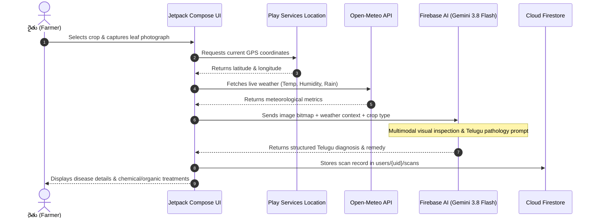

# Rythu Mitra (రైతు మిత్ర) – AI-Powered Telugu Farmer Assistant

[](https://kotlinlang.org)
[](https://developer.android.com/jetpack/compose)
[](https://firebase.google.com)
[](https://deepmind.google/technologies/gemini/)
[](https://developer.android.com)

**Rythu Mitra (రైతు మిత్ర)** is an intelligent, Telugu-first agricultural companion designed specifically for farmers in Andhra Pradesh and Telangana. By bridging modern artificial intelligence with native language accessibility, Rythu Mitra empowers farmers to instantly diagnose crop diseases through camera photos, receive real-time hyper-local weather intelligence, manage seasonal crops, and receive automated smart agricultural advisories tailored to their localized farming conditions.

---

## Table of Contents
1. [Project Introduction](#1-project-introduction)
2. [Problem Statement](#2-problem-statement)
3. [Project Objectives](#3-project-objectives)
4. [Key Features](#4-key-features)
5. [Technology Stack](#5-technology-stack)
6. [Application Architecture](#6-application-architecture)
7. [Firebase Integration](#7-firebase-integration)
8. [AI Crop Disease Detection Workflow](#8-ai-crop-disease-detection-workflow)
9. [Weather Intelligence](#9-weather-intelligence)
10. [Smart Farmer Alerts](#10-smart-farmer-alerts)
11. [Firestore Data Storage](#11-firestore-data-storage)
12. [Installation and Setup Instructions](#12-installation-and-setup-instructions)
13. [Build Instructions](#13-build-instructions)
14. [Screenshots](#14-screenshots)
15. [Future Enhancements](#15-future-enhancements)
16. [Author and Project Credits](#16-author-and-project-credits)

---

## 1. Project Introduction

Agriculture remains the lifeblood of millions of rural households across Telugu-speaking regions. However, smallholder farmers often struggle with delayed crop disease diagnosis, unexpected weather fluctuations, and generic agricultural guidance that does not consider local microclimates or specific crop growth stages.

**Rythu Mitra** addresses this gap as a dedicated, mobile-first agricultural assistant operating natively in Telugu. Powered by **Google Gemini 3.8 Flash** via **Firebase AI Logic**, **Cloud Firestore**, and live meteorological feeds, the application provides an intuitive, high-speed, and accessible tool directly in the farmer's hands.

---

## 2. Problem Statement

Farmers routinely face significant crop yield loss and economic hardship due to:
- **Language Barriers in Agritech:** Most state-of-the-art agricultural apps and advisory platforms deliver advice exclusively in English or complex technical jargon, rendering them inaccessible to regional farmers.
- **Delayed Plant Pathology:** Identifying pest attacks and fungal, bacterial, or viral diseases typically requires waiting for agricultural extension officers or visiting distant Krishi Vigyan Kendras (KVKs).
- **Unpredictable Weather Risks:** Abrupt rainfall during harvesting or high humidity during flowering triggers severe fungal outbreaks and damage without early warning.
- **Fragmented Farm Recordkeeping:** Smallholder farmers lack organized, digital systems to track planting dates, growth milestones, and historical disease treatments across their crop fields.

---

## 3. Project Objectives

- **Democratize Agricultural AI:** Provide instant, free, and multimodal AI crop diagnostics in clear, colloquial Telugu.
- **Deliver Hyper-Local Weather Forewarning:** Integrate live GPS-based weather data with predictive rainfall and storm alarms.
- **Context-Aware Smart Alerts:** Generate automated alerts mapping crop growth stages against meteorological risk thresholds (e.g., flowering moisture risk, heat stress, pest vulnerability).
- **Frictionless Farmer Experience:** Eliminate cumbersome sign-up procedures through automated Firebase Anonymous Authentication, allowing instant access with cloud persistence.
- **Reliable Offline and Low-Bandwidth Capability:** Build a lightweight, responsive Jetpack Compose application designed to run smoothly on budget Android devices.

---

## 4. Key Features

- 🌿 **AI Crop Disease Diagnosis (ఫోటో ద్వారా రోగ నిర్ధారణ):**
  Capture or upload photos of diseased plant leaves. Google Gemini analyzes the visual symptoms alongside current ambient weather metrics to deliver precise disease diagnosis and recommended remedies in Telugu.
- 🌦️ **Live Weather & Microclimate Dashboard (ప్రత్యక్ష వాతావరణం):**
  Real-time tracking of temperature, relative humidity, wind velocity, precipitation, and rain probability based on device geolocation.
- 🚨 **Rule-Based Smart Alert Engine (రైతు హెచ్చరికలు):**
  Automated alerts triggered by severe weather forecasts (heavy rain, gale-force winds, high heat waves) and crop phenological stages (flowering protection, pest monitoring).
- 🌾 **My Crops Management (నా పంటలు):**
  Log and track individual crops, crop varieties, planting dates, ongoing growth stages, water requirements, and field notes.
- 📜 **Historical Scan Records (స్కాన్ చరిత్ర):**
  Archive previous disease scans and diagnostic recommendations in Firestore for long-term field health tracking.
- 👤 **Farmer Profile (రైతు వివరాలు):**
  Store farmer profile information including name, village, primary crops, and landholding acreage.
- 🛡️ **Enterprise-Grade Security:**
  Firebase App Check with reCAPTCHA Enterprise verification ensures API integrity and prevents unauthorized abuse.

---

## 5. Technology Stack

| Layer | Technology |
|---|---|
| **Language** | Kotlin 2.0+ |
| **UI Toolkit** | Jetpack Compose (Material Design 3) |
| **Architecture** | Clean Architecture / Repository Pattern |
| **AI / LLM Engine** | Google Gemini 3.8 Flash (`com.google.firebase:firebase-ai`) |
| **Authentication** | Firebase Authentication (Anonymous Auth) |
| **Cloud Database** | Cloud Firestore (`com.google.firebase:firebase-firestore`) |
| **App Security** | Firebase App Check (reCAPTCHA Enterprise & Debug Provider) |
| **Weather API** | Open-Meteo REST API (Free & Open Source Meteorological API) |
| **Location Services** | Google Play Services Location (`play-services-location`) |
| **Image & Camera** | Activity Result Contracts (Camera & Gallery Pickers) |
| **Build System** | Gradle Kotlin DSL (`build.gradle.kts`) with Version Catalogs |
| **Target Android SDK** | Android 14+ (API 34 to API 37) |
| **Minimum Android SDK** | Android 7.0 Nougat (API 24) |

---

## 6. Application Architecture

Rythu Mitra adheres to clean Android architecture principles:

```
┌────────────────────────────────────────────────────────┐
│                   UI Layer (Jetpack Compose)           │
│  - MainActivity                                        │
│  - AlertsScreen                                        │
│  - ScanHistoryScreen                                   │
│  - Theme / Material 3 Design System                    │
└───────────────────────────▲────────────────────────────┘
                            │
┌───────────────────────────┴────────────────────────────┐
│                   Domain / Engine Layer                │
│  - SmartAlertEngine (Rules & Priority Sorting)         │
│  - FarmerAlert Data Models                             │
└───────────────────────────▲────────────────────────────┘
                            │
┌───────────────────────────┴────────────────────────────┐
│                    Data / Repository Layer             │
│  - CropRepository (Firestore CRUD for crops)           │
│  - ProfileRepository (Firestore CRUD for farmer info)  │
│  - ScanRepository (Firestore CRUD for scan history)    │
│  - FirebaseAuthManager (Anonymous Auth Session)        │
└───────────────────────────▲────────────────────────────┘
                            │
┌───────────────────────────┴────────────────────────────┐
│               External Services & Cloud APIs           │
│  - Google Gemini 3.8 Flash (Firebase AI SDK)           │
│  - Cloud Firestore Cloud Database                      │
│  - Open-Meteo API                                      │
│  - Google Play Services Fused Location                 │
└────────────────────────────────────────────────────────┘
```

---

## 7. Firebase Integration

The application integrates modern Firebase products for backend agility and security:

1. **Firebase Authentication (`firebase-auth`):**
   Implements silent, zero-friction anonymous sign-in via `FirebaseAuthManager`. Farmers can immediately use all app features without having to remember passwords or configure credentials. The unique Firebase User ID (`uid`) isolates data per farmer.
2. **Cloud Firestore (`firebase-firestore`):**
   Stores crop metadata, farmer profile information, and scan archives. Structured subcollections ensure strict per-user authorization boundaries.
3. **Firebase AI Logic (`firebase-ai`):**
   Connects directly to Google's Gemini models using `GenerativeBackend.googleAI()`. Utilizing Gemini 3.8 Flash, the model accepts image bitmaps along with contextual weather parameters to produce localized agricultural reasoning.
4. **Firebase App Check (`firebase-appcheck-recaptcha`):**
   Safeguards backend resources against bots, scrapers, and malicious callers by validating authentic app instances through reCAPTCHA Enterprise.

---

## 8. AI Crop Disease Detection Workflow



---

## 9. Weather Intelligence

Hyper-local weather metrics are fetched in real-time based on the farmer's GPS coordinates using Open-Meteo:
- **Current Temperature (°C):** Critical for monitoring heat stress during seed germination and fruit setting.
- **Relative Humidity (%):** Detects conditions exceeding 85%, which accelerate fungal pathogens (e.g., powdery mildew, leaf spot).
- **Precipitation & Rain Probability (%):** Guides irrigation timing and pesticide spray schedules to avoid chemical runoff.
- **Wind Speed (km/h):** Warns against spraying when drift risk is elevated (>25 km/h) or when physical crop lodging could occur.
- **Next-Day Forecast:** Provides early warnings for severe weather, thunderstorms, or cloud bursts.

---

## 10. Smart Farmer Alerts

The `SmartAlertEngine` analyzes live weather conditions in conjunction with the farmer's active crops to dynamically generate prioritized agricultural advisories:

| Alert Trigger | Condition | Priority | Telugu Advisory Summary |
|---|---|---|---|
| **Storm Warning** | Weather Code 95, 96, 99 | High (1) | రాబోయే తుఫాను హెచ్చరిక – పొలంలో జాగ్రత్తలు తీసుకోండి |
| **Heavy Rain Alert** | Rain Probability ≥ 70% | High (1) | భారీ వర్ష సూచన – పురుగుమందుల పిచికారీ నిలిపివేయండి |
| **Wind Alert** | Wind Speed ≥ 25 km/h | High (1) | వేగంగా వీచే గాలులు – ఎరువులు లేదా స్ప్రేయింగ్ చేయవద్దు |
| **Extreme Heat** | Temperature ≥ 40°C | High (1) | తీవ్రమైన వేడి – పంటలకు సకాలంలో నీటి తడులు అందించండి |
| **Fungal Disease Risk**| Humidity ≥ 85% | Medium (2) | అధిక తేమ – శిలీంధ్ర తెగుళ్లు ఆశించే అవకాశం ఉంది |
| **Flowering Stage Alert**| Crop in పూత దశ (Flowering)| Medium (2) | పూత దశ జాగ్రత్తలు – నీటి నిల్వ లేకుండా చూసుకోండి |
| **Vegetative Monitoring**| Crop in పెరుగుదల దశ (Growth)| Medium (2) | పెరుగుదల దశ – చీడపీడల గమనింపు అవసరం |

---

## 11. Firestore Data Storage

User data in Cloud Firestore is scoped under the authenticated farmer's UID:

```
users/
└── {userId}/
    ├── profile/
    │   └── info
    │       ├── farmerName: String
    │       ├── village: String
    │       ├── mainCrop: String
    │       └── landSize: String
    │
    ├── crops/
    │   └── {cropId}
    │       ├── id: String
    │       ├── name: String
    │       ├── cropType: String
    │       ├── plantedDate: String
    │       ├── growthStage: String
    │       ├── waterRequirement: String
    │       ├── notes: String
    │       └── createdAt: Long
    │
    └── scans/
        └── {scanId}
            ├── id: String
            ├── cropName: String
            ├── result: String
            └── createdAt: Long
```

---

## 12. Installation and Setup Instructions

### Prerequisites
- Android Studio Ladybug (2024.2.1) or newer
- JDK 11 or JDK 17
- Android SDK with Platform 34+
- A physical Android device or emulator running Android 7.0+ (API 24+)
- A Firebase project with Authentication, Firestore, and Vertex AI/Gemini enabled

### Clone and Open
```bash
git clone https://github.com/shaikafnan787-hash/RythuMitraApp.git
cd rythu-mitra
```

### Firebase Setup
1. Create a Firebase project in the [Firebase Console](https://console.firebase.google.com/).
2. Add an Android application with package name:
   ```
   com.Afnan.rythumitraapp
   ```
3. Enable **Anonymous Authentication** in the Firebase Console under **Authentication > Sign-in method**.
4. Enable **Cloud Firestore** in your desired region and configure security rules.
5. Enable **Firebase AI Logic / Vertex AI in Firebase** to allow Gemini API calls.
6. Download your generated `google-services.json` file and place it in the `app/` directory:
   ```
   RythuMitraApp/app/google-services.json
   ```

---

## 13. Build Instructions

### Building with Gradle

Open a terminal in the root directory:

- **Build Debug APK:**
  ```bash
  ./gradlew assembleDebug
  ```
- **Install Debug APK on Connected Device:**
  ```bash
  ./gradlew installDebug
  ```
- **Run Unit Tests:**
  ```bash
  ./gradlew test
  ```
- **Run Android Lint:**
  ```bash
  ./gradlew lint
  ```

---

## 14. Screenshots

| Home & Weather | AI Disease Scan | Smart Alerts | My Crops & Profile |
|:---:|:---:|:---:|:---:|
| *(Screenshot Placeholder)* | *(Screenshot Placeholder)* | *(Screenshot Placeholder)* | *(Screenshot Placeholder)* |

---

## 15. Future Enhancements

- 🎙️ **Telugu Voice Assistant (వాయిస్ కమాండ్లు):** Integration of speech-to-text and text-to-speech for completely hands-free voice interactions in rural dialects.
- 📡 **Offline Edge ML Models:** On-device TensorFlow Lite / MediaPipe models for disease detection when internet connectivity is unavailable in remote farmlands.
- 📈 **Mandi Market Prices (మార్కెట్ ధరలు):** Real-time commodity price tracking across regional agricultural market committees (APMCs) in Andhra Pradesh and Telangana.
- 💧 **IoT Soil Sensor Integration:** Connecting soil moisture and NPK sensors over Bluetooth Low Energy (BLE) for precision irrigation scheduling.
- 🤝 **Community Farmer Forum (రైతు వేదిక):** Peer-to-peer knowledge sharing and expert consultation for pest outbreak alerts across nearby villages.

---

## 16. Author and Project Credits

- **Developer & Creator:** [Shaik Irshad / Afnan](https://github.com/shaikafnan787-hash)
- **GitHub Profile:** [@shaikafnan787-hash](https://github.com/shaikafnan787-hash)
- **Project Repository:** [rythu-mitra](https://github.com/shaikafnan787-hash/RythuMitraApp)
- **Acknowledgments:**
  - [Google Gemini API](https://deepmind.google/technologies/gemini/) for multimodal reasoning and Telugu agricultural guidance.
  - [Google Firebase](https://firebase.google.com/) for real-time cloud infrastructure, authentication, and security.
  - [Open-Meteo](https://open-meteo.com/) for open meteorological data access.
  - The farming community of Andhra Pradesh & Telangana for inspiration and feedback.

---

*Dedicated to empowering our farmers with technology — జై జవాన్, జై కిసాన్!*
